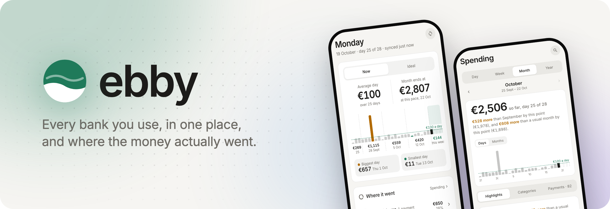

<picture>
  <source media="(prefers-color-scheme: dark)" srcset="docs/banner-dark.png">
  
</picture>

**ebby** is a self-hosted spending app for Greek banks. Connect every bank you use and see where your money
went, and whether the month is on track, before it's over.

- Every Greek bank [Enable Banking](https://enablebanking.com) supports: Piraeus, National Bank of Greece, Eurobank, Alpha Bank, Revolut and more
- Spending by category, against last month and your own plan
- Goals, weekly habits, and alerts when a category runs ahead
- An optional AI assistant (with an Anthropic key)
- Invite friends: each person connects their own banks and sees only their own money

## Try it

You need [Docker](https://docs.docker.com/get-docker/). This fills the app with six months of made-up spending:

```bash
git clone https://github.com/gthanasis/ebby && cd ebby
cp .env.example .env && echo DEMO=1 >> .env
docker compose up -d
docker compose exec ebby ebby demo-seed
```

Open http://localhost:8000.

## Run it for real

1. **Enable Banking**: make a free account at [enablebanking.com](https://enablebanking.com) and create an
   application in *restricted* mode. Link your bank accounts to it, add `https://<your address>/eb-callback`
   as a redirect URL, and download its `.pem` key.
2. **Google sign-in**: create an [OAuth client](https://console.cloud.google.com/auth/clients) (Web application)
   with `https://<your address>/auth/callback` as a redirect URI.
3. **Settings**: `cp .env.example .env` and fill it in. Each line says what it's for.
4. **Start**: `docker compose up -d`, open your address and sign in with the `ADMIN_EMAIL` account. The app walks
   you through adding your Enable Banking key and connecting your banks.

Invite others from **Settings → People**. Each of them sets up their own Enable Banking app the same way.

## Updating

`docker compose pull && docker compose up -d`. Your install follows one major version (`ghcr.io/gthanasis/ebby:0`
in `compose.yaml`), so updates never need anything from you. A new major version only arrives when you change that
number, and its [release notes](https://github.com/gthanasis/ebby/releases) say what to do first.

## Support

ebby is free for personal use. If it helps you, you can
[buy me a coffee through GitHub Sponsors](https://github.com/sponsors/gthanasis).

## Licence

Source-available for noncommercial use: [PolyForm Noncommercial 1.0.0](LICENSE.md) and the
[additional terms](TERMS.md). It may not be used to train AI models. Commercial licences may be offered later.

Not affiliated with Enable Banking or any bank.
